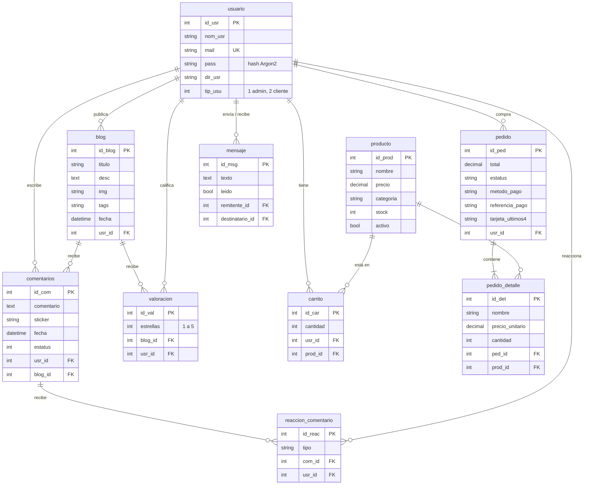

# 🎂 Pastelería Mimi · Blog de pasteles

Blog móvil donde los clientes de **Pastelería Mimi** comparten y comentan pasteles.
Cada publicación tiene foto, descripción (sabor, relleno, glaseado, receta), etiquetas, autor
y comentarios. La pastelería (cuenta de administrador) también modera usuarios y publicaciones.

| Capa | Tecnología |
|---|---|
| App móvil | Flutter (Dart) |
| API REST | FastAPI (Python) + SQLAlchemy |
| Base de datos | MySQL 8 |
| Seguridad | Contraseñas con Argon2 · sesiones con JWT · permisos por rol |

## Funcionalidades

- **Registro e inicio de sesión** con validación de datos y contraseña de mínimo 8 caracteres.
- **Blog de pasteles**: ver publicaciones propias y de otros usuarios, con filtro por etiquetas (Chocolate, Frutas, Bodas…) y la pestaña **Mis pasteles**.
- **Publicar un pastel** con nombre, descripción, foto (URL) y etiquetas.
- **Comentarios**: leer y escribir comentarios en cada pastel.
- **Eliminar**: el autor puede borrar sus publicaciones y comentarios; el administrador puede borrar cualquiera.
- **Perfil**: cada usuario edita sus datos.
- **Administrador**: gestión de usuarios (crear, editar, eliminar) y alta de otros administradores.

### Módulos opcionales (alcance extendido)

| Módulo | Qué incluye |
|---|---|
| 🛒 **Venta y comercio electrónico** | Catálogo de productos con categorías y stock · carrito de compras guardado por usuario · proceso de pago en línea (tarjeta en **modo de prueba** o efectivo al recibir) · historial de pedidos con estatus · el cliente puede cancelar antes de que se prepare · el administrador gestiona productos y cambia el estatus de los pedidos (si se cancela, el inventario regresa). |
| ⭐ **Puntuación / valoración** | Cada usuario califica cada pastel con 1–5 estrellas (puede cambiar o quitar su calificación). Las tarjetas del blog muestran el promedio y el número de votos. |
| 😍 **Comentarios interactivos** | Reacciones con emoji en cada comentario (❤️ 👍 🤤 😂 😮 😢, con contador y animación) · 8 stickers animados que se pueden enviar solos o junto al texto · panel de emojis para insertar en el comentario. |
| 💬 **Mensajería interna** | Chat privado entre usuarios registrados (por ejemplo, un cliente con la pastelería) · bandeja con último mensaje y contador de no leídos · palomitas de leído · se actualiza solo cada pocos segundos. |

**Pago de prueba** (no se cobra dinero real; solo se guardan los últimos 4 dígitos):

| Tarjeta | Resultado |
|---|---|
| `4242 4242 4242 4242` | Pago aprobado |
| `4000 0000 0000 0002` | Pago rechazado (fondos insuficientes) |

Usa cualquier fecha futura (MM/AA) y cualquier CVV de 3 dígitos.

## Estructura del repositorio

```
.
├── Backend_API/            # API en FastAPI
│   ├── bd.sql              # Modelo de base de datos (MySQL)
│   ├── seed.py             # Datos de ejemplo (usuarios, pasteles, comentarios)
│   ├── main.py             # Endpoints del blog, valoraciones y reacciones
│   ├── tienda.py           # Productos, carrito, pago y pedidos
│   ├── mensajes.py         # Mensajería interna
│   ├── security.py         # Argon2 + JWT + control de acceso por rol
│   ├── models.py           # Modelos ORM
│   ├── schemas.py          # Validación de entrada/salida
│   ├── database.py         # Conexión a MySQL
│   ├── requirements.txt
│   └── .env.example
└── proyecto/               # App Flutter
    └── lib/
        ├── main.dart       # Rutas y tema
        ├── config.dart     # URL de la API
        ├── theme.dart      # Colores de Pastelería Mimi
        ├── models/         # PostModel, ComentarioModel, UserModel
        ├── services/       # Acceso a datos (API) y sesión
        ├── screens/        # Login, registro, blog, detalle, publicar, perfil, usuarios,
        │                   # tienda, carrito, pago, pedidos, productos (admin), mensajes, chat
        └── widgets/        # Tarjeta de post, menú lateral, chips, etc.
```

## Modelo de datos



## Instalación y uso

### Requisitos
Python 3.10+, MySQL 8 y Flutter SDK.

### 1. Base de datos
```bash
mysql -u root -p < Backend_API/bd.sql
```
> `bd.sql` borra y recrea las tablas. Úsalo en desarrollo.
>
> ¿Ya tenías la base de datos de la versión anterior y no quieres borrarla? No pasa nada:
> al iniciar, la API crea las tablas nuevas y agrega la columna `sticker` sola, y `python seed.py`
> agrega los productos y mensajes de ejemplo sin duplicar lo que ya existe.

### 2. API
```bash
cd Backend_API
python -m venv venv
venv\Scripts\activate            # Windows   (Mac/Linux: source venv/bin/activate)
pip install -r requirements.txt

copy .env.example .env           # Windows   (Mac/Linux: cp .env.example .env)
```
Abre `.env` y escribe tu contraseña de MySQL y una `SECRET_KEY`
(genera una con `python -c "import secrets; print(secrets.token_hex(32))"`).

Carga los datos de ejemplo e inicia el servidor:
```bash
python seed.py
uvicorn main:app --reload --host 0.0.0.0 --port 8000
```
Documentación interactiva: <http://127.0.0.1:8000/docs>

**Cuentas de ejemplo** (solo desarrollo):

| Rol | Correo | Contraseña |
|---|---|---|
| Administrador | `admin@pasteleriamimi.com` | `Admin12345` |
| Cliente | `adriana@ejemplo.com` | `Cliente12345` |

### 3. App Flutter
```bash
cd proyecto
flutter pub get
flutter run
```

La app elige sola la URL de la API:

| Dónde corre | URL usada |
|---|---|
| Web, Windows, macOS, Linux, simulador iOS | `http://127.0.0.1:8000` |
| Emulador Android | `http://10.0.2.2:8000` |
| Celular físico (misma red Wi‑Fi) | `flutter run --dart-define=API_URL=http://IP_DE_TU_PC:8000` |

## Endpoints

| Método | Ruta | Descripción | Acceso |
|---|---|---|---|
| POST | `/login` | Inicia sesión y devuelve el token JWT | Público |
| POST | `/usuarios` | Registro de cliente | Público |
| GET | `/me` | Usuario de la sesión | Sesión |
| GET | `/usuarios` | Listar usuarios | Admin |
| PUT | `/usuarios/{id}` | Editar usuario | Dueño o admin |
| DELETE | `/usuarios/{id}` | Eliminar usuario | Admin |
| GET | `/blog?mias=true` | Listar pasteles (todos o propios) | Sesión |
| GET | `/blog/{id}` | Ver un pastel | Sesión |
| POST | `/blog` | Publicar pastel | Sesión |
| DELETE | `/blog/{id}` | Eliminar pastel | Autor o admin |
| GET | `/blog/{id}/comentarios` | Listar comentarios | Sesión |
| POST | `/blog/{id}/comentarios` | Comentar | Sesión |
| DELETE | `/comentarios/{id}` | Eliminar comentario | Autor o admin |
| PUT | `/blog/{id}/valoracion` | Calificar con 1–5 estrellas | Sesión |
| DELETE | `/blog/{id}/valoracion` | Quitar mi calificación | Sesión |
| POST | `/comentarios/{id}/reacciones` | Poner/quitar reacción (emoji) | Sesión |
| GET | `/productos?todos=true` | Catálogo (inactivos solo admin) | Sesión |
| POST / PUT / DELETE | `/productos[/{id}]` | Gestionar productos | Admin |
| GET | `/carrito` | Ver carrito | Sesión |
| POST | `/carrito` | Agregar producto | Sesión |
| PUT / DELETE | `/carrito/{prod_id}` | Cambiar cantidad / quitar | Sesión |
| DELETE | `/carrito` | Vaciar carrito | Sesión |
| POST | `/pedidos/checkout` | Pagar y crear pedido | Sesión |
| GET | `/pedidos?todos=true` | Mis pedidos (todos si es admin) | Sesión |
| POST | `/pedidos/{id}/cancelar` | Cancelar mi pedido | Dueño |
| PUT | `/pedidos/{id}/estatus` | Cambiar estatus | Admin |
| GET | `/contactos` | Usuarios a quienes escribir | Sesión |
| GET | `/mensajes/conversaciones` | Bandeja de conversaciones | Sesión |
| GET | `/mensajes/no-leidos` | Contador de no leídos | Sesión |
| GET | `/mensajes/{usuario_id}?despues_de=` | Ver chat (marca como leído) | Sesión |
| POST | `/mensajes/{usuario_id}` | Enviar mensaje | Sesión |

## Seguridad implementada

- **Contraseñas** con hash **Argon2** (`pwdlib`); nunca se guardan ni se devuelven en texto plano.
- **Sesiones con JWT** firmado (HS256) y con expiración (120 min por defecto). El token viaja en `Authorization: Bearer ...`.
- **Control de acceso por rol**: todas las rutas del blog exigen sesión; solo el autor o un administrador pueden borrar; solo un administrador puede listar/eliminar usuarios o crear otros administradores.
- **El rol no lo decide el cliente**: el registro público siempre crea cuentas de cliente, y el autor de cada publicación o comentario se toma de la sesión.
- **Login seguro**: mensaje genérico (no revela si el correo existe) y correo único.
- **Validación** de longitud y formato en servidor (Pydantic) y en la app.
- **Pagos**: nunca se guarda el número completo de la tarjeta ni el CVV (solo los últimos 4 dígitos); el total se calcula en el servidor con los precios de la BD, no con lo que envía la app; el inventario se bloquea durante el pago.
- **Mensajes privados**: cada quien solo puede leer las conversaciones en las que participa; el directorio de contactos no expone correos.
- **Secretos fuera del repositorio**: `.env` está en `.gitignore`; solo se sube `.env.example`.

## Notas

- La pantalla "¿Olvidaste tu contraseña?" es solo la interfaz (aún no envía correos).
- Las fotos de ejemplo vienen de un servicio externo; si alguna no carga, la app muestra un ícono de pastel. Puedes reemplazarlas por tus propias URLs al publicar.
- El pago con tarjeta es una pasarela simulada para fines académicos. Para cobrar de verdad se conectaría un proveedor (Stripe, Mercado Pago, Conekta…) en `tienda.py`.
- Para producción: usar HTTPS, restringir `allow_origins` en CORS y cambiar las contraseñas de ejemplo.
